# M7Lab: Converting the Program Launcher to an .exe with PyInstaller

**William Beckham · CSC-221 Advanced Python Programming**

This document records every step of turning `launcher.py` into a stand-alone
Windows executable, with a screenshot for each step.

> **Everything here was done on my own PC.** Windows 11 Pro, AMD Ryzen 9 7900X,
> Python 3.14.6, PyInstaller 6.22.3. Every screenshot is a capture of my
> desktop taken while the step ran: the command prompt window on the left,
> Microsoft Edge on the right.

- **Part 1:** build the .exe: virtual environment, packages, unit tests, PyInstaller
- **Part 2:** run the .exe: the launcher menu and all three Flask programs, each closed with its own **Exit** button
- **Part 3:** files the .exe creates, and the submission zip

Text records of the run are in [`local_build/`](local_build/):

- [`build_exe_console.txt`](local_build/build_exe_console.txt): everything the build printed
- [`exe_run_transcript.txt`](local_build/exe_run_transcript.txt): the launcher window during the whole .exe run
- [`exe_check_results.txt`](local_build/exe_check_results.txt): the pass/fail list for the .exe run

---

## Part 1: Building the .exe

`build_exe.bat` does the whole conversion in five steps. I ran it in a
Command Prompt window in the project folder.

### 1.1 Create and activate the virtual environment (steps 1 and 2)

The venv keeps PyInstaller and the project's packages separate from my main
Python install. `where python` shows the venv's `python.exe` comes first,
so the venv is active.

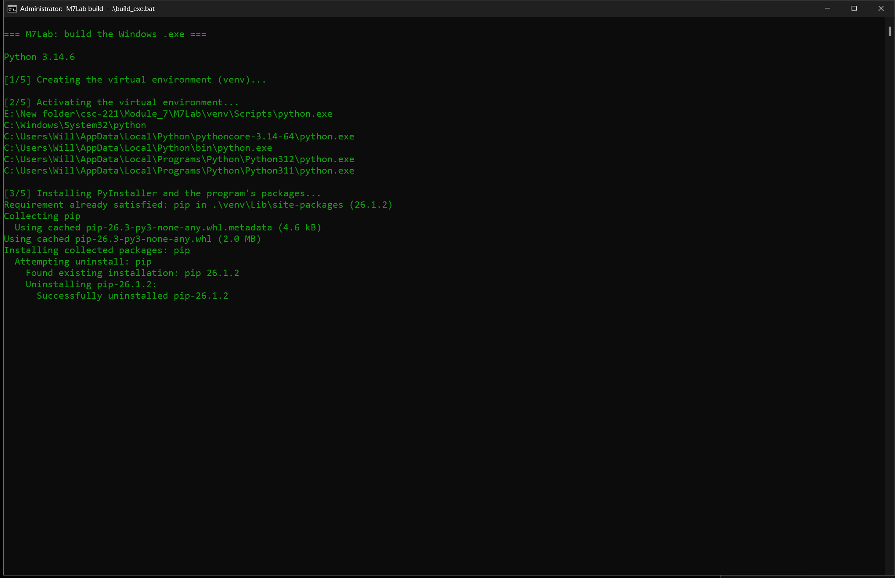

### 1.2 Install PyInstaller and the program's packages into the venv (step 3)

`requirements.txt` lists flask, pandas, openpyxl and pyinstaller.
`pyinstaller --version` confirms it installed.

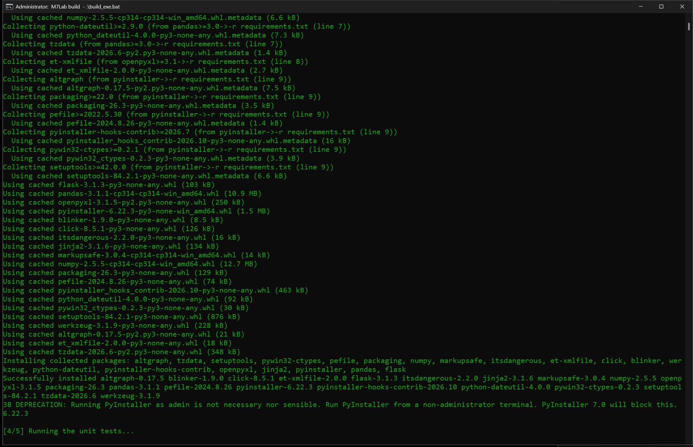

### 1.3 Run the unit tests inside the venv (step 4)

All **70** unit tests pass before anything is built. That includes the new
tests for the Exit button (see Part 2). If any test failed, the script would
stop here and not build the .exe.

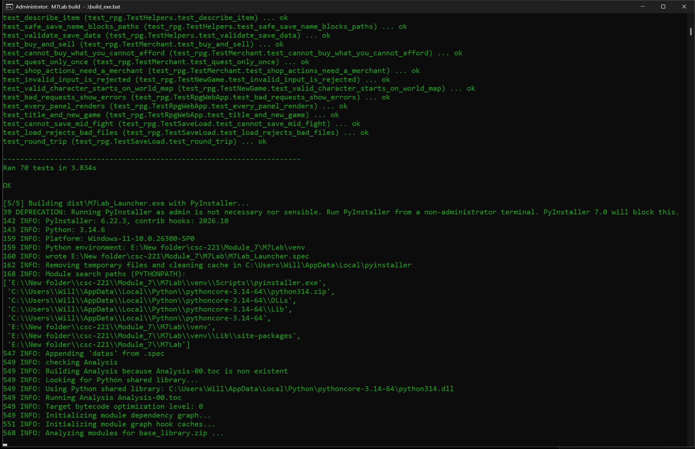

### 1.4 Build the executable with PyInstaller (step 5)

```bat
pyinstaller --onefile --console --clean --noconfirm --name M7Lab_Launcher ^
    --add-data "templates;templates" ^
    --add-data "vet_app\data;vet_app\data" ^
    --add-data "recipe_app\data;recipe_app\data" ^
    --add-data "rpg_app\game\data;rpg_app\game\data" ^
    --hidden-import openpyxl ^
    launcher.py
```

| Option | Why |
|---|---|
| `--onefile` | Packs everything into a single .exe file |
| `--console` | Keeps a command prompt window, because the launcher menu needs typed input |
| `--clean --noconfirm` | Starts from a clean build and overwrites old output without asking |
| `--name M7Lab_Launcher` | Names the output file |
| `--add-data "templates;templates"` | Bundles the HTML pages (Flask needs them at run time) |
| `--add-data "vet_app\data;vet_app\data"` | Bundles `vet_serv.db` |
| `--add-data "recipe_app\data;recipe_app\data"` | Bundles `recipe_data.xlsx` |
| `--add-data "rpg_app\game\data;rpg_app\game\data"` | Bundles the Dungeon RPG's game data (7 JSON files) |
| `--hidden-import openpyxl` | pandas loads openpyxl in a way PyInstaller can't see, so it has to be named |
| `launcher.py` | The entry point: the file whose menu the user sees |

The `DEPRECATION: Running PyInstaller as admin` line appears because my command
prompt was running as Administrator. It doesn't affect the build. A normal
(non-admin) Command Prompt works the same way without the warning.

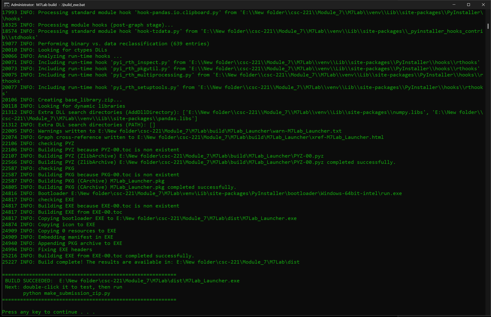

### 1.5 The finished .exe in `dist\`

PyInstaller creates `build\` (temporary work files) and `dist\` (the finished
program). `dist\M7Lab_Launcher.exe` is the whole program in one file, about
36 MB.

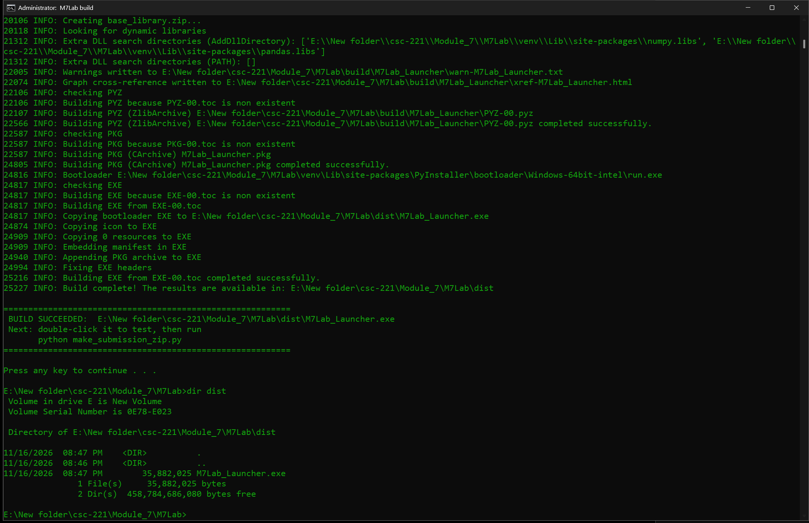

---

## Part 2: Running the .exe

I started `dist\M7Lab_Launcher.exe` on its own: no venv activated and no
`python` command. It opens in a command prompt window and shows the launcher
menu.

### 2.1 The launcher menu and an invalid choice

Typing `9` shows an error and the menu again. It doesn't crash.

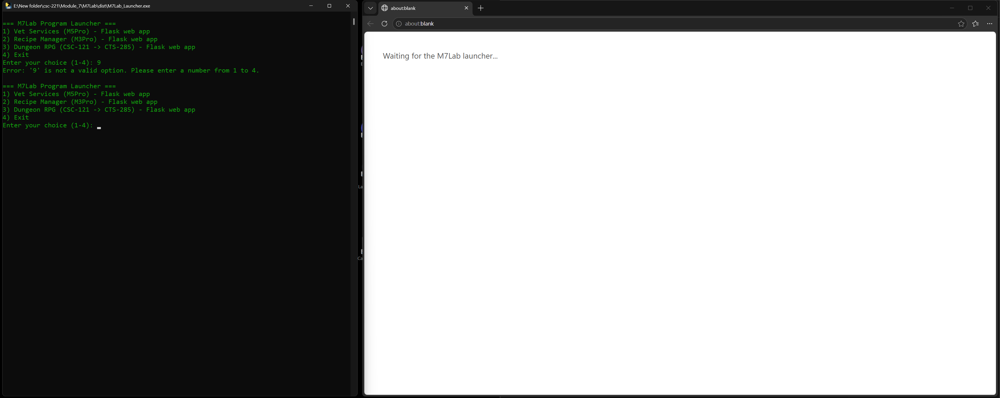

### 2.2 Choice 1: Vet Services (M5Pro)

The launcher starts the Flask app and opens it in the browser. Every page has
a red **✕ Exit app** button in the top-right corner. The launcher window
tells the user to click it when they're done.

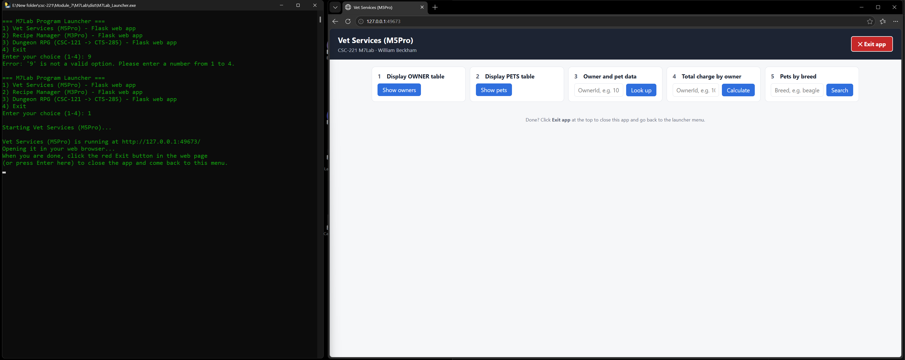

**OWNER table** (also saved to `output\owner.csv`)

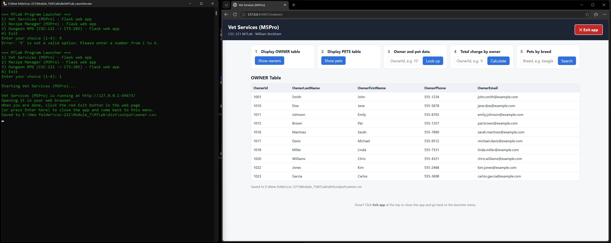

**Pets by breed:** total and average charge

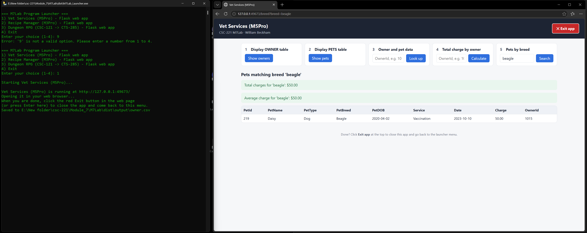

**Exception handling:** an OwnerId that isn't a number shows an error message, not a crash.

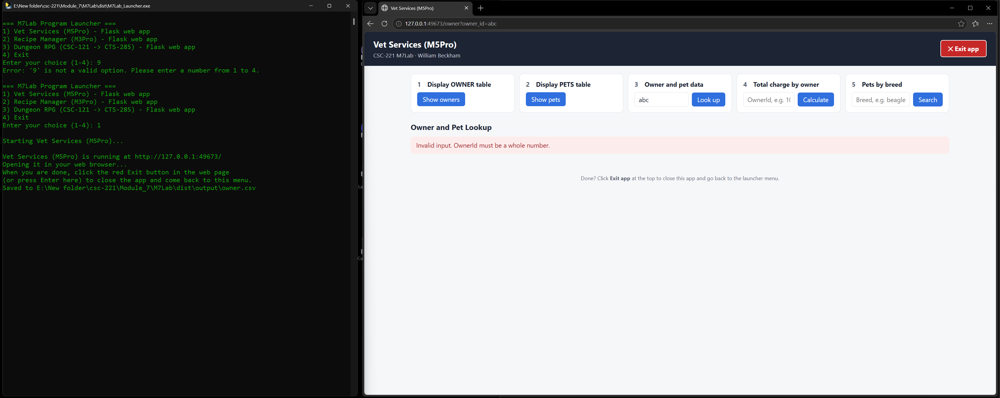

**Exit app:** clicking the button shows a "has been closed" page that
tells the user to go back to the launcher window. The launcher stops the web
app by itself, prints *"Vet Services (M5Pro) was closed from the web page."*,
and shows the menu again so the user can choose what to do next.

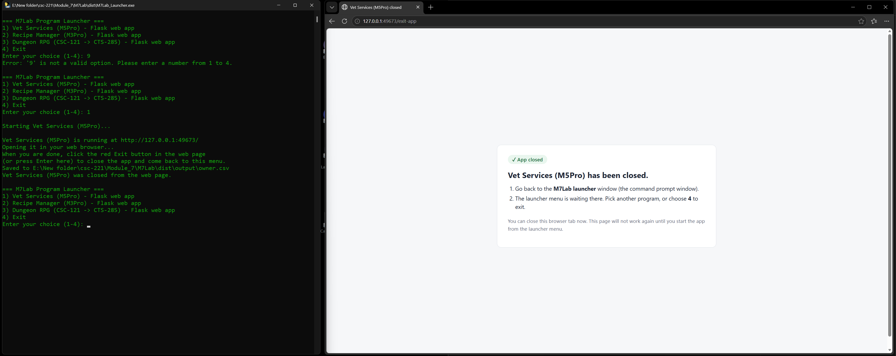

### 2.3 Choice 2: Recipe Manager (M3Pro)

**View all recipes.** Caesar Salad's missing spice level is reported instead of showing 1.

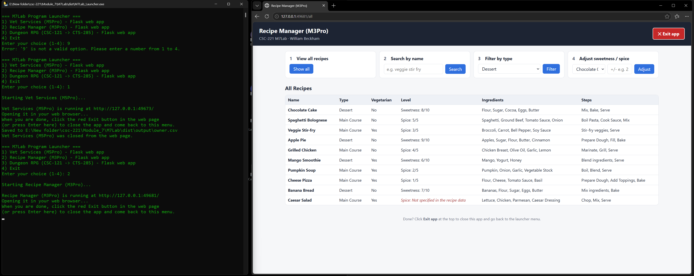

**Search ignores punctuation:** "veggie stir fry" finds "Veggie Stir-fry".

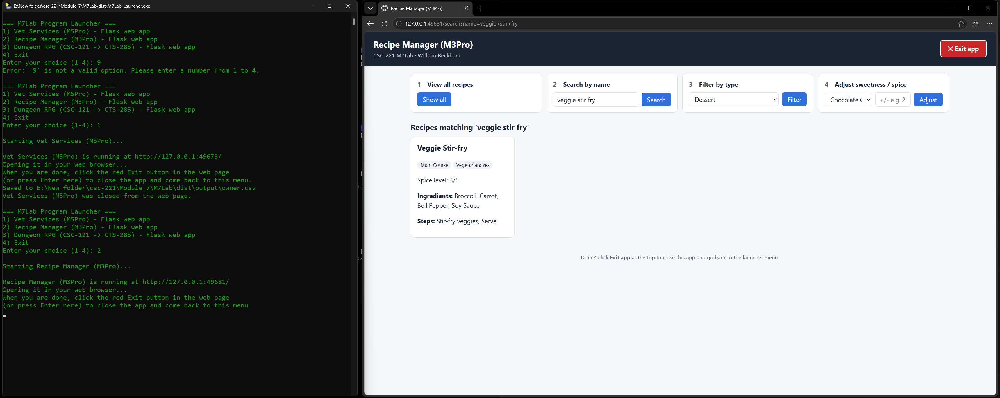

**Adjust sweetness / spice** uses `adjust_sweetness()` / `adjust_spice()`.


**Exit app** takes the user back to the launcher menu.

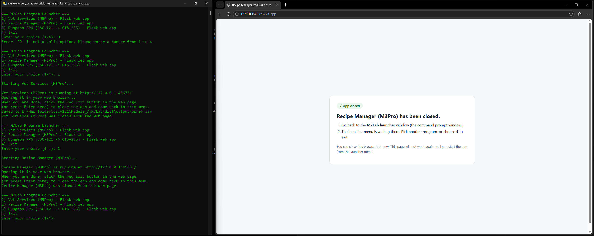

### 2.4 Choice 3: Dungeon RPG (CSC-121 → CTS-285)

**Create a character.** The red **✕ Exit game** button is in the top-right corner.

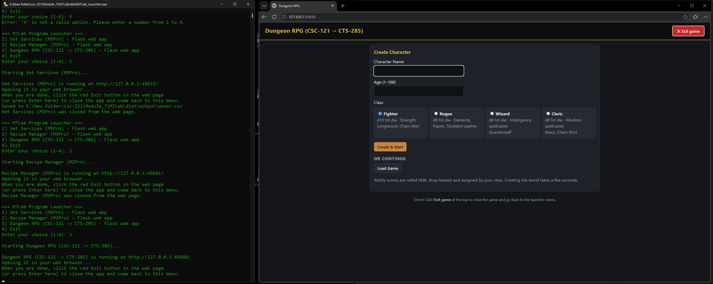

**World map**

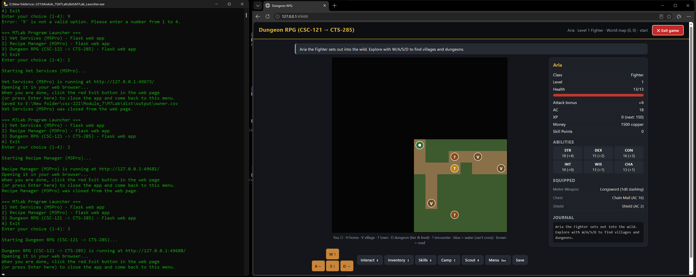

**Pause menu (Esc)** also has **✕ Exit to Launcher**. Unlike the other two
programs, the game has progress that can be lost, so both RPG exit buttons
ask *"Any progress you have not saved will be lost"* before closing.

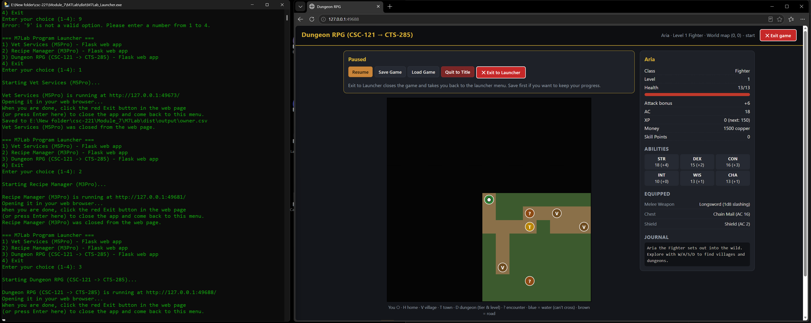

After confirming, the game closes and the launcher shows the menu again.

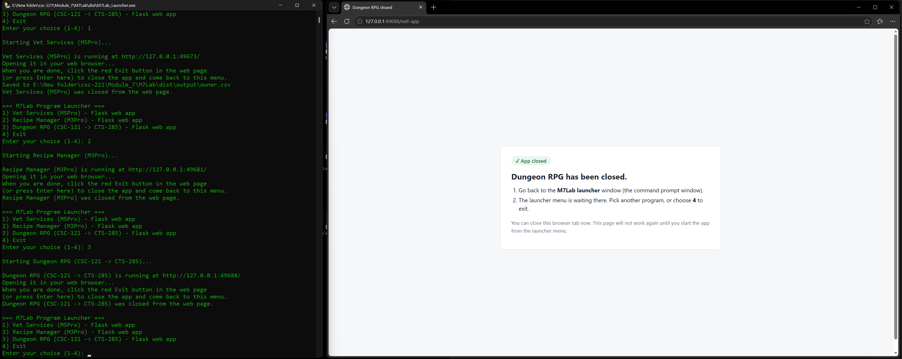

### 2.5 Choice 4: Exit

The launcher says **Goodbye!** and waits for Enter before the window closes,
so the message can be read.

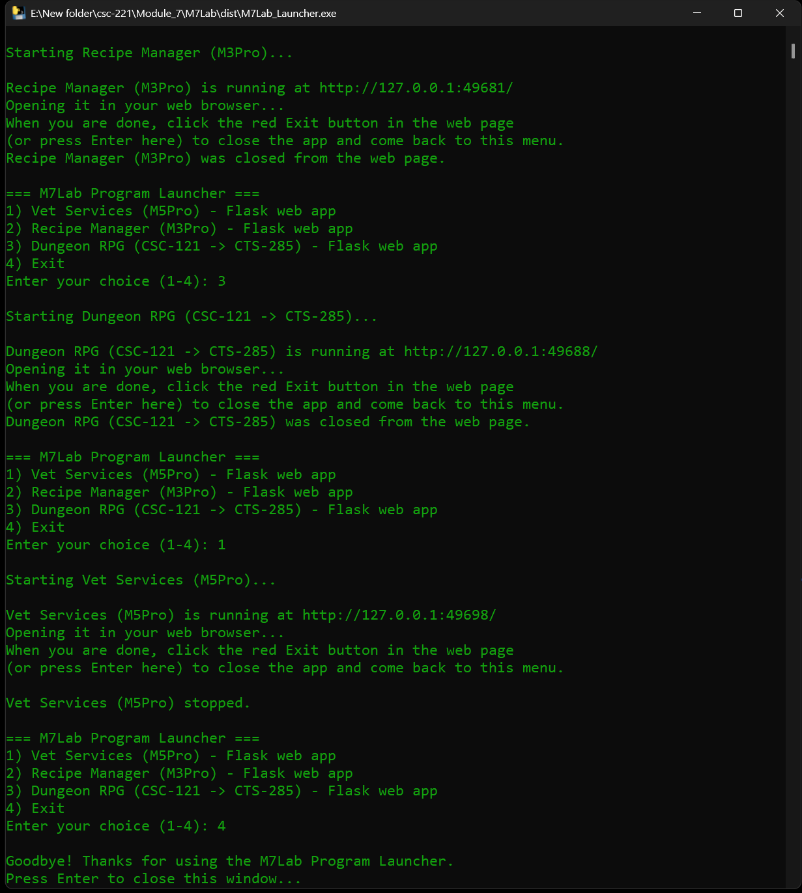

### How the Exit button works

| Piece | What it does |
|---|---|
| `web_exit.py` | Adds a `POST /exit-app` route to each Flask app. It sends the "has been closed" page, **then** calls the launcher's stop function, so the page reaches the browser before the server stops. |
| `templates/base.html`, `templates/rpg/game.html` | Put the red Exit button on every page of all three programs. |
| `launcher.py` | Gives each app a stop function (`app.config["ON_EXIT"]`). It waits for **either** the Exit button **or** Enter in the launcher window. A small `Keyboard` class reads the keyboard on a background thread, because a plain `input()` can't also notice the button. |
| `launcher.py` `turn_off_quick_edit()` | In a Windows console, clicking the window starts "Select" mode, which freezes the program until Esc is pressed. The launcher turns that mode off, so clicking its window to bring it to the front doesn't make it look hung. |

The Exit route only accepts a button click (POST). Just visiting the address
can't close the app.

**Automated check of the .exe on my PC: 20 of 20 passed**
([`exe_check_results.txt`](local_build/exe_check_results.txt)): menu, invalid
choice, every page above, each program's Exit button returning to the menu,
Enter in the launcher window also stopping an app, the web server really
stopping, Goodbye, exit code 0, and the CSV and log files.

---

## Part 3: Output files and the submission zip

### 3.1 Files the .exe created

CSV output goes in `output\`, log files in `logs\` and RPG save games in
`saves\`, all **next to the .exe**, not inside PyInstaller's temporary
folder. That way they're still there after the program closes.

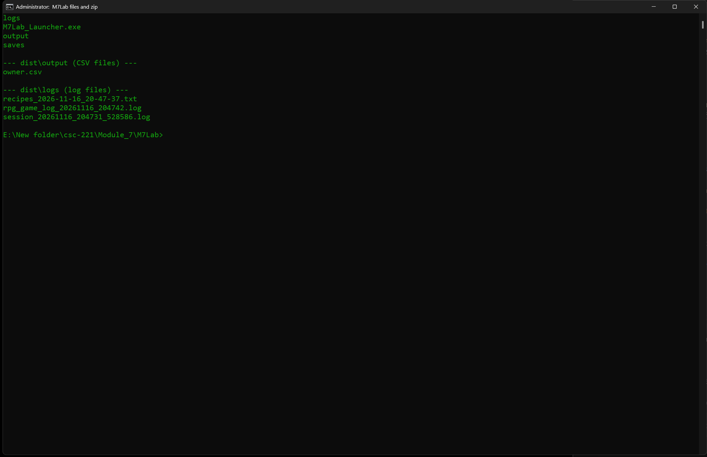

### 3.2 The submission zip (code + exe, no venv)

`make_submission_zip.py` zips the code and the .exe, leaving out the venv,
`build\` and the run-time folders.

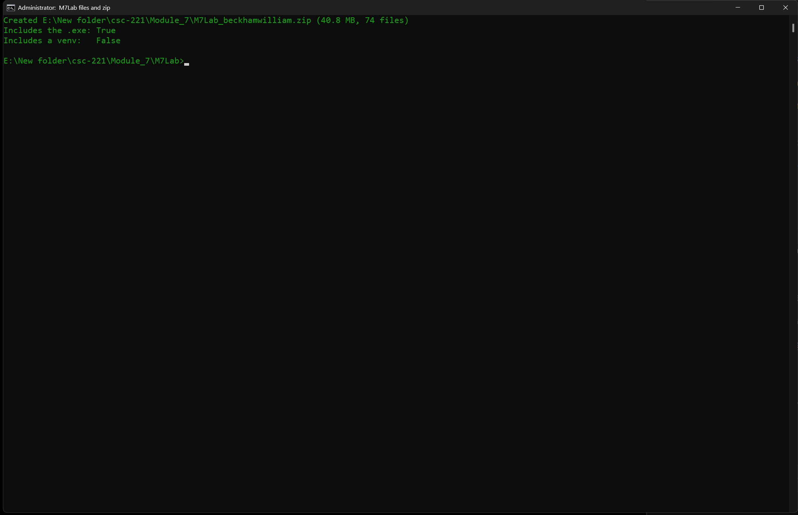

---

## Building it yourself

On any Windows PC with Python from python.org (tick **"Add python.exe to
PATH"** when installing), double-click **`build_exe.bat`**, or run the steps
one at a time in Command Prompt from the project folder:

```bat
python -m venv venv
venv\Scripts\activate
pip install -r requirements.txt
python -m unittest discover -s tests
pyinstaller --onefile --console --clean --noconfirm --name M7Lab_Launcher ^
    --add-data "templates;templates" ^
    --add-data "vet_app\data;vet_app\data" ^
    --add-data "recipe_app\data;recipe_app\data" ^
    --add-data "rpg_app\game\data;rpg_app\game\data" ^
    --hidden-import openpyxl ^
    launcher.py
python make_submission_zip.py
```

The .exe appears in `dist\`. Double-click it to run. If Windows shows
**"Windows protected your PC"**, click **More info → Run anyway**.
PyInstaller programs aren't digitally signed, so SmartScreen warns about them.

## Troubleshooting

| Problem | Fix |
|---|---|
| `'python' is not recognized` | Reinstall Python from python.org and tick **Add python.exe to PATH**, then open a new Command Prompt. |
| `'build_exe.bat' is not recognized` when typed in Command Prompt | Type `.\build_exe.bat` instead, or double-click it in File Explorer. |
| `Python was not found; run without arguments to install from the Microsoft Store` | Install Python from python.org, or turn off **Settings → Apps → Advanced app settings → App execution aliases → python.exe / python3.exe**. |
| Antivirus deletes or quarantines the .exe | PyInstaller one-file programs sometimes trigger false alarms. Restore the file, or add an exception for the `dist` folder. |
| The first start of a program takes a while | The one-file .exe unpacks itself each time it starts, and antivirus may scan the unpacked files. Later starts are faster. |
| The browser doesn't open | Copy the `http://127.0.0.1:...` address shown in the launcher window into your browser. |
| The browser tab still shows an app after closing it | Click **Exit** on the page, or press Enter in the launcher window. Either one stops the app. |
| `Could not create the zip ... not found` | The .exe hasn't been built yet. Run `build_exe.bat` first. |
