# M7Lab: Converting the Program Launcher to an .exe with PyInstaller

**William Beckham · CSC-221 Advanced Python Programming**

This document records every step of turning `launcher.py` into a stand-alone
executable, with a screenshot for each step.

- **Part 1:** the program being converted, and its unit tests
- **Part 2:** creating the virtual environment, installing PyInstaller and building
- **Part 3:** building and running the Windows `.exe`, and making the submission zip

> **Note on screenshots:** the terminal images in Parts 1 and 2 are the real
> output of each command, captured as it ran. Part 3 uses screenshots taken on
> Windows.

---

## Part 1: The program being converted

### 1.1 Launcher menu (input, results, Goodbye message)

The launcher asks the user to pick one of three programs, rejects invalid
input, starts the chosen Flask app, and says **Goodbye!** before closing.

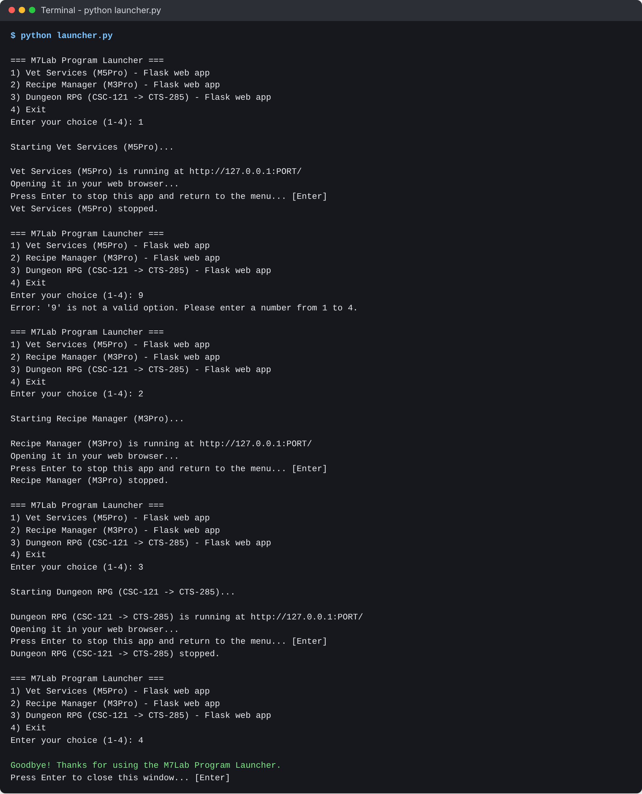

### 1.2 Vet Services (M5Pro) Flask app

**Option 1: OWNER table** (also saved to `output/owner.csv`)


**Option 4: Total charge by owner**

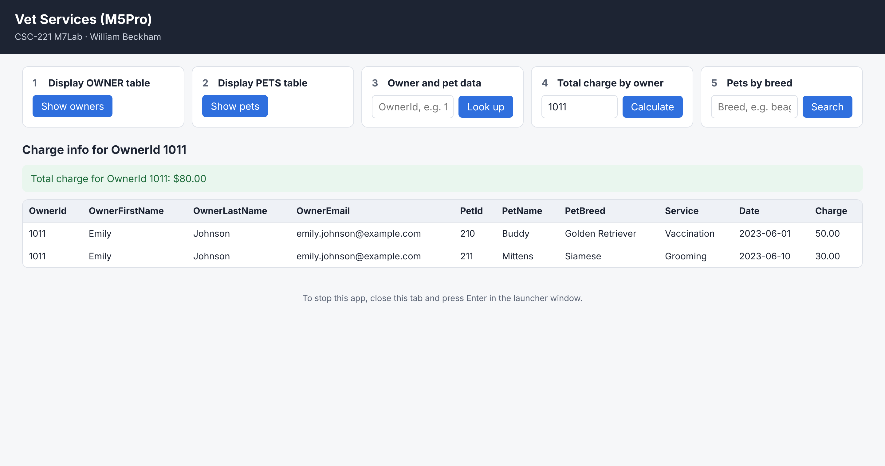

**Option 5: Pets by breed (total and average charge)**


**Exception handling: invalid OwnerId**

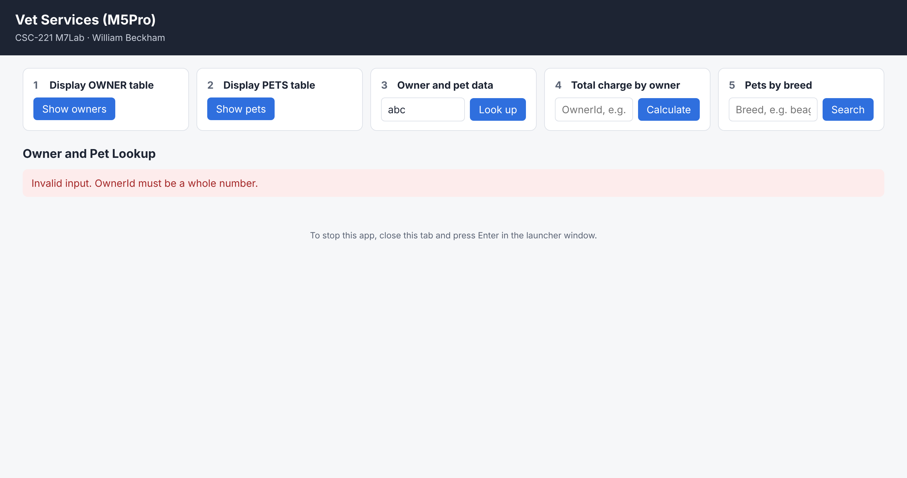

### 1.3 Recipe Manager (M3Pro) Flask app

**View all recipes.** Caesar Salad's missing spice level is now reported
instead of showing 1 (instructor feedback #1).

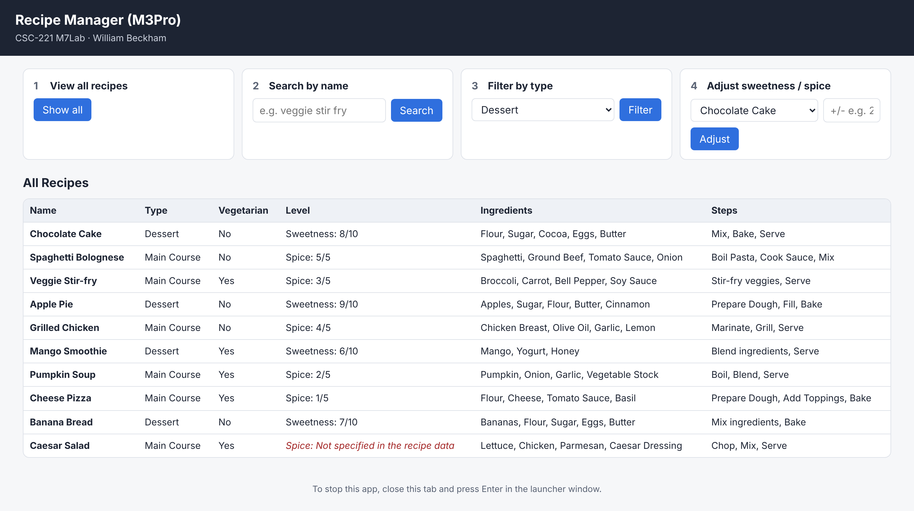

**Search ignores punctuation:** "veggie stir fry" finds "Veggie Stir-fry" (feedback #3).

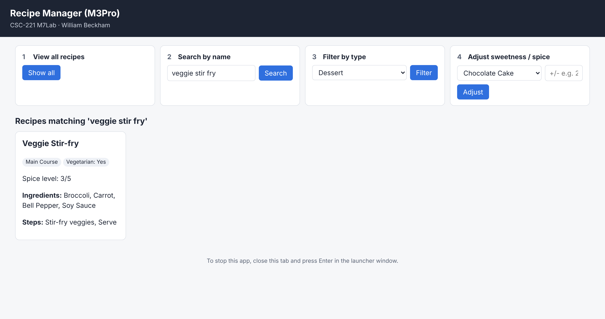

**New option: adjust sweetness/spice** uses `adjust_sweetness()` / `adjust_spice()` (feedback #2).

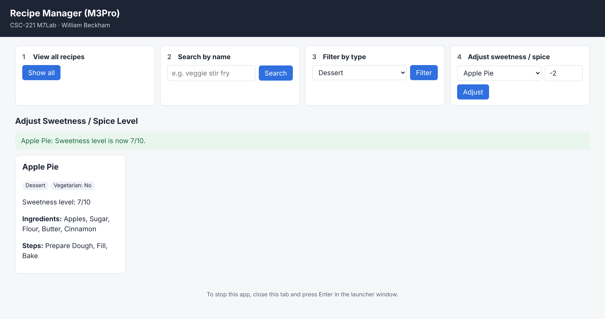

**Exception handling: a recipe with no level to adjust**


### 1.4 Dungeon RPG (started in CSC-121, built up in CTS-285) Flask app

The Tkinter desktop game was rewritten as web pages. The game rules are the
original code; only the screens changed. Keyboard controls (W/A/S/D, E, I,
K, C, R, Esc) work in the browser.

**Create a character.** Bad input (blank name, an age that isn't 1-100) shows an error.

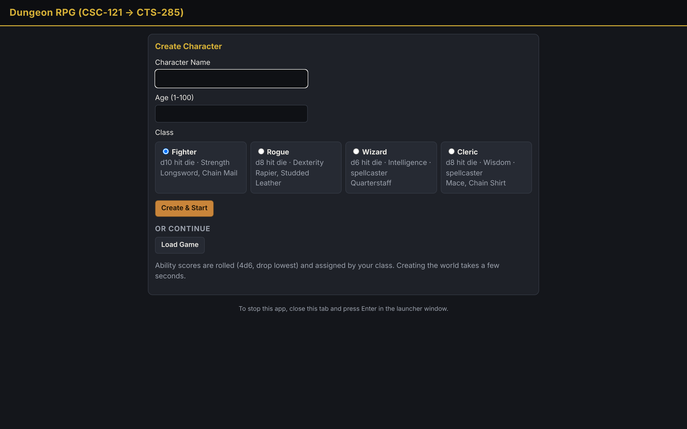

**World map:** villages, towns, dungeons (with tier and level) and encounters.

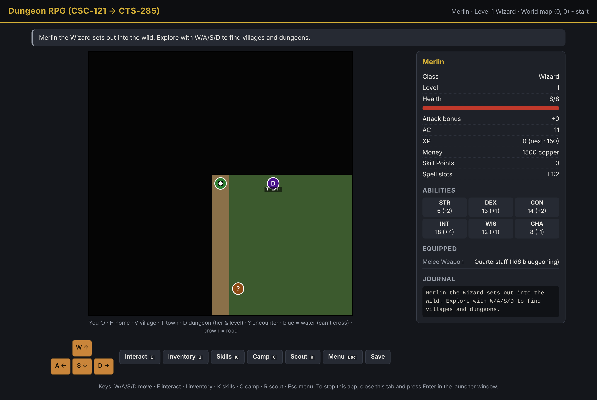

**Village: quest board** (a d20 ability check vs DC) **and shop**


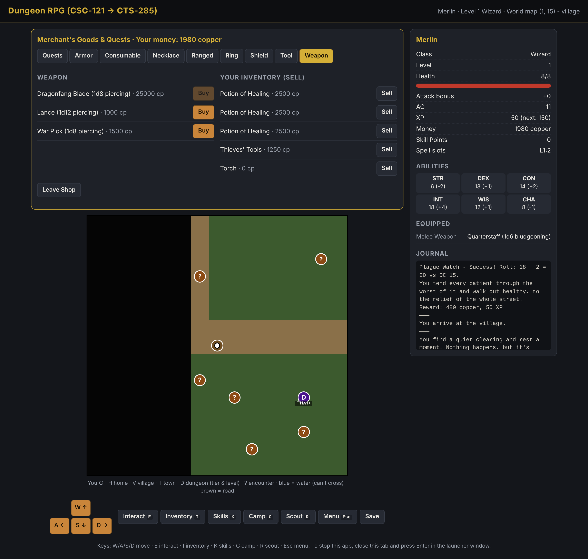

**Dungeon:** limited vision, doors, enemies, treasure, merchant and boss vault.


**Combat:** range bands, attack, advance/retreat, spells, abilities, items and flee.


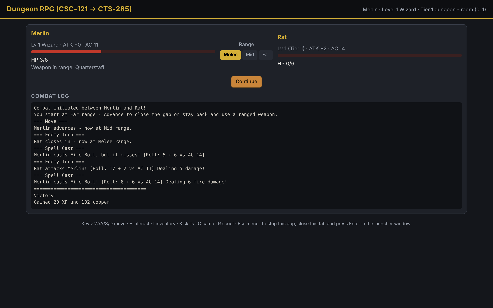

**Inventory, skill tree and pause menu (save/load)**


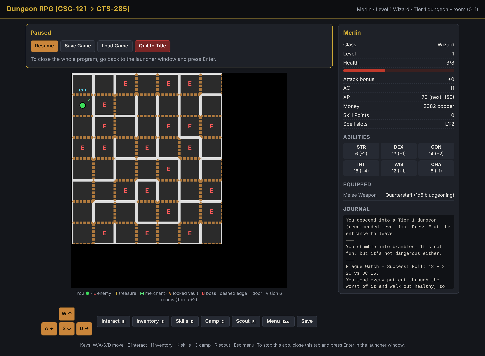

**Phone-width layout**


### 1.5 Exception handling: missing database (M5Pro instructor feedback)

With `vet_serv.db` deleted on purpose, the launcher reports the problem and
returns to the menu instead of crashing.

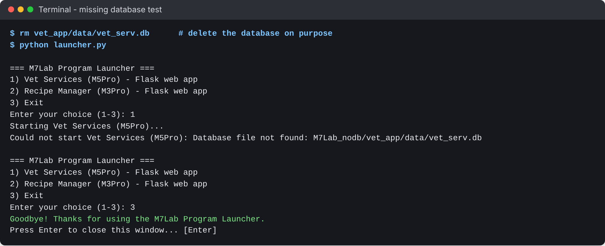

### 1.6 Unit tests (63 tests, all passing)


---

## Part 2: Virtual environment, PyInstaller and the build

This part was done on Linux to prove the whole process works before building
on Windows. PyInstaller always builds for the operating system it runs on, so
this produces a Linux program. Part 3 repeats the same steps on Windows to
make the `.exe`.

### 2.1 Create and activate a virtual environment

The venv keeps PyInstaller and the project's packages separate from the
system Python. `which python` shows we're now using the venv's Python.

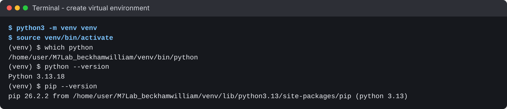

### 2.2 Install PyInstaller and the project's packages into the venv

`requirements.txt` lists flask, pandas, openpyxl and pyinstaller.

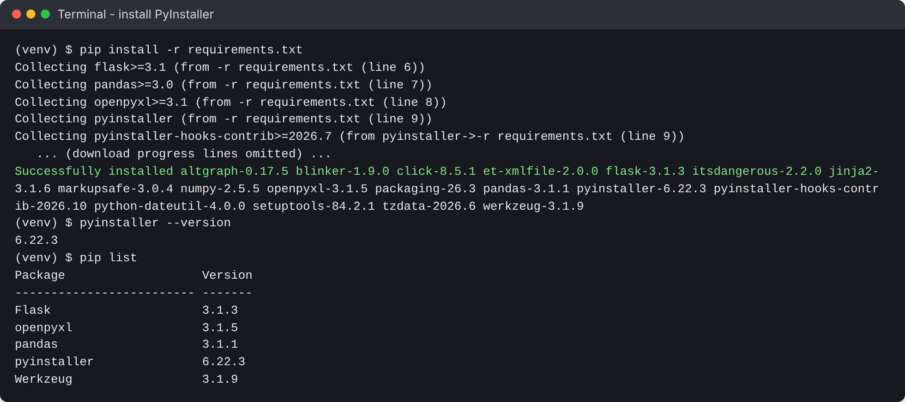

### 2.3 Run the unit tests inside the venv

All the unit tests pass, which confirms the program works in the venv before converting it.


### 2.4 Build the executable with PyInstaller

| Option | Why |
|---|---|
| `--onefile` | Packs everything into a single executable file |
| `--console` | Keeps a console window, because the launcher menu needs typed input |
| `--clean --noconfirm` | Starts from a clean build and overwrites old output without asking |
| `--name M7Lab_Launcher` | Names the output file |
| `--add-data "templates:templates"` | Bundles the HTML pages (Flask needs them at run time) |
| `--add-data "vet_app/data:vet_app/data"` | Bundles `vet_serv.db` |
| `--add-data "recipe_app/data:recipe_app/data"` | Bundles `recipe_data.xlsx` |
| `--add-data "rpg_app/game/data:rpg_app/game/data"` | Bundles the Dungeon RPG's game data (classes, items, enemies, spells, skills, quests: 7 JSON files) |
| `--hidden-import openpyxl` | pandas loads openpyxl in a way PyInstaller can't see, so we name it |
| `launcher.py` | The entry point, the file whose menu the user sees |

The two `WARNING` lines are about `user32` and `msvcrt`, which are Windows
system libraries that don't exist on Linux. They don't affect the program.

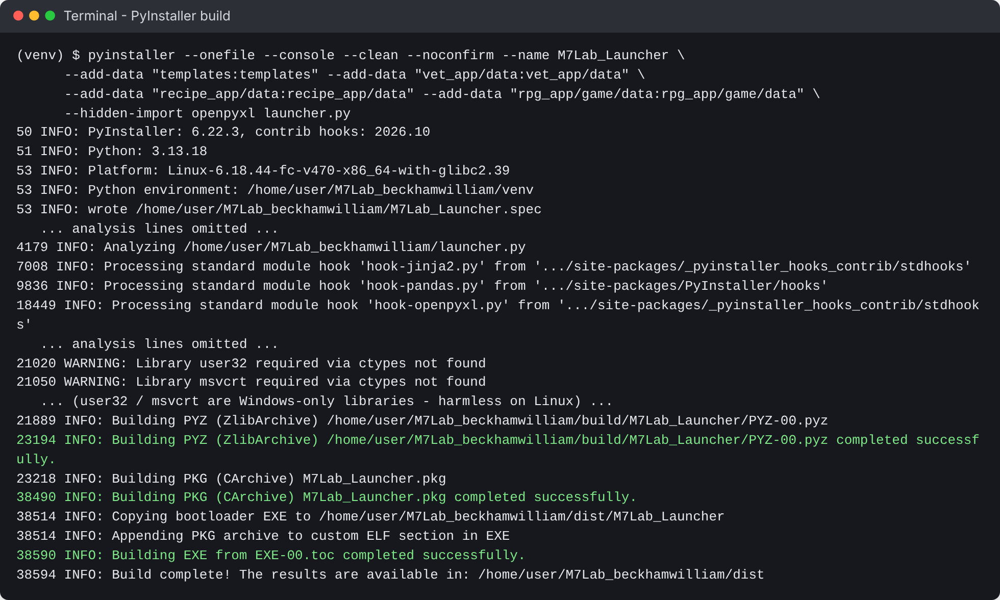

### 2.5 The result in `dist/`

PyInstaller creates `build/` (temporary work files), `dist/` (the finished
program) and `M7Lab_Launcher.spec` (the saved build settings).

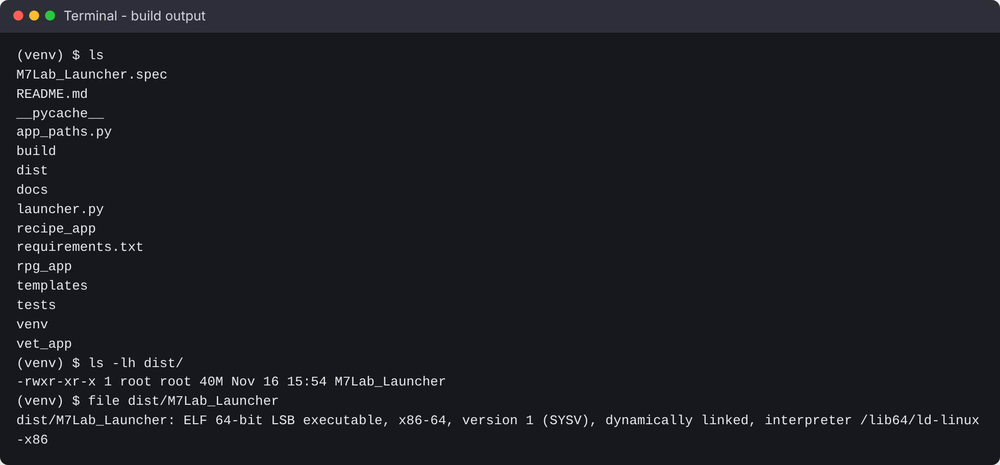

### 2.6 Run the executable on its own

The executable was copied **by itself** into an empty folder and run with no
venv and no Python. It shows the menu, rejects an invalid choice (`9`), runs
all three Flask apps, and says **Goodbye!** before closing.


While it ran, both apps were opened in a browser. These pages were served by
the executable:

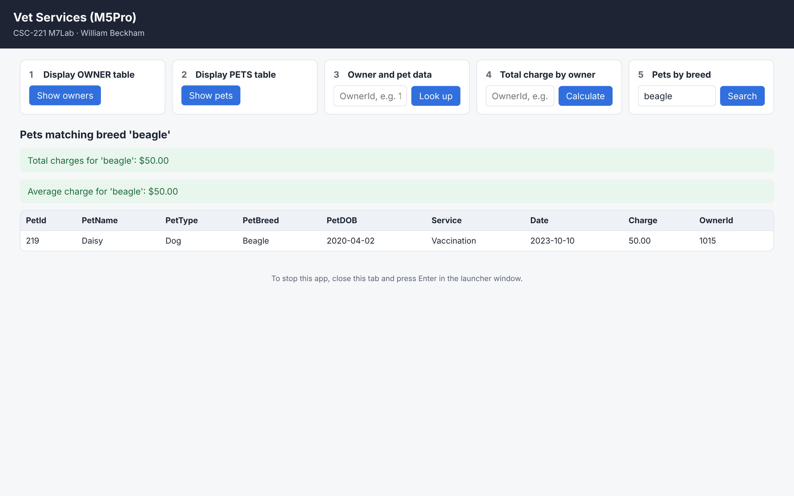


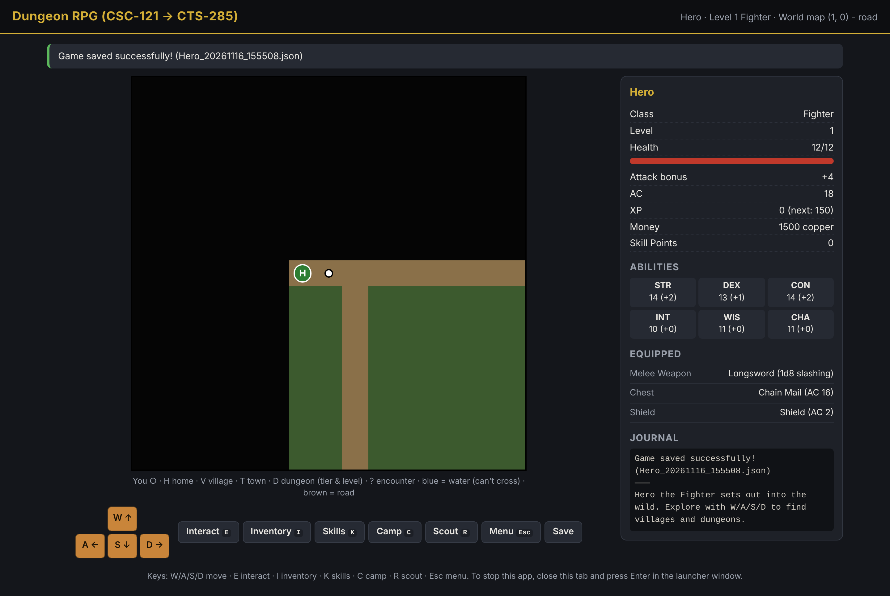

### 2.7 Files the executable created

The CSV output, the RPG save game and the log files are written **next to the
executable**, not inside PyInstaller's temporary folder, so they're still there
after the program closes. Each program keeps its own log file.


**Automated check of the built program: 14 of 14 passed.**

| Program | Checks |
|---|---|
| Vet Services | home page; OWNER table and CSV save; total charge for owner 1011 ($80.00); breed average ($50.00); bad-OwnerId error |
| Recipe Manager | missing level reported; punctuation-insensitive search; level adjustment |
| Dungeon RPG | title screen; bad age rejected; new game shows the world map; moving; inventory panel; saving a game |

The program exited with code 0.

---

## Part 3: Windows .exe

PyInstaller builds for the operating system it runs on, so the Windows `.exe`
has to be built on Windows. These are the same steps as Part 2. Command
Prompt uses `venv\Scripts\activate` instead of `source venv/bin/activate`,
and `;` instead of `:` inside `--add-data`.

**You need:** Windows 10 or 11 and Python from python.org. Tick **"Add
python.exe to PATH"** in the installer.

> 📸 **Screenshots:** for each step, press **Win + Shift + S**, capture the
> window, and save it into `docs\screenshots\` with the file name shown.
> The image then appears in this document automatically.

> ⚡ **Shortcut:** `build_exe.bat` runs steps 3.2 to 3.6 in one go.
> Double-click it, or type `build_exe.bat` in Command Prompt. For the
> screenshots, typing each command yourself, as shown below, gives the
> clearest picture of every step.

### 3.1 Open Command Prompt in the project folder

In File Explorer, open the `M7Lab_beckhamwilliam` folder, click the address
bar, type `cmd` and press Enter.

📸 `05_01_win_cmd.png`


### 3.2 Create the virtual environment

```bat
python --version
python -m venv venv
```

📸 `05_02_win_venv.png`


### 3.3 Activate it

The prompt starts with `(venv)` once it's active.

```bat
venv\Scripts\activate
where python
```

📸 `05_03_win_activate.png`


### 3.4 Install PyInstaller and the program's packages

```bat
pip install -r requirements.txt
pyinstaller --version
```

📸 `05_04_win_pip_install.png` (the end, showing "Successfully installed ..." and the version)

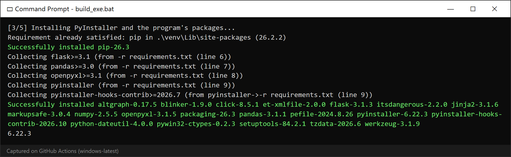

### 3.5 Run the unit tests

```bat
python -m unittest discover -s tests
```

It should end with `Ran 63 tests` and `OK`.

📸 `05_05_win_tests.png`


### 3.6 Build the .exe

Copy and paste the whole command. The `^` at the end of each line continues
it onto the next line in Command Prompt.

```bat
pyinstaller --onefile --console --clean --noconfirm --name M7Lab_Launcher ^
    --add-data "templates;templates" ^
    --add-data "vet_app\data;vet_app\data" ^
    --add-data "recipe_app\data;recipe_app\data" ^
    --add-data "rpg_app\game\data;rpg_app\game\data" ^
    --hidden-import openpyxl ^
    launcher.py
```

It takes about a minute and should end with `Build complete!`.

📸 `05_06_win_build.png` (the end of the output)


### 3.7 The .exe in `dist\`

Open the `dist` folder in File Explorer.

📸 `05_07_win_dist.png`


### 3.8 Run the .exe

Double-click `dist\M7Lab_Launcher.exe`. The first start takes a few seconds
while it unpacks.

> If Windows shows **"Windows protected your PC"**, click **More info → Run
> anyway**. PyInstaller programs aren't digitally signed, so SmartScreen
> warns about them. This is normal.

Pick each program, look at it in the browser, press Enter in the launcher
window to stop it, and finish with `4` (Exit).

📸 `05_08_win_exe_menu.png` (the launcher menu)

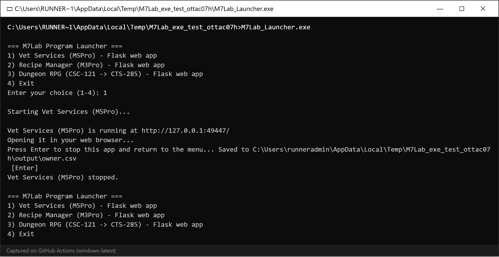

📸 `05_09_win_exe_vet.png` (Vet Services in the browser)


📸 `05_10_win_exe_recipe.png` (Recipe Manager in the browser)


📸 `05_11_win_exe_rpg.png` (Dungeon RPG in the browser)


📸 `05_12_win_exe_goodbye.png` (the "Goodbye!" message after choosing 4)


### 3.9 Files the .exe created

Next to `M7Lab_Launcher.exe` in `dist\` you'll now see `output\` (CSV
files), `logs\` and, if you saved a game, `saves\`.

📸 `05_13_win_exe_files.png`


### 3.10 Make the submission zip (code + exe, no venv)

```bat
python make_submission_zip.py
```

This creates `M7Lab_beckhamwilliam.zip` next to the project folder. It
contains the Python code, data, tests, docs and `dist\M7Lab_Launcher.exe`,
and leaves out `venv\`, `build\`, saves, logs and caches.

📸 `05_14_win_zip.png`

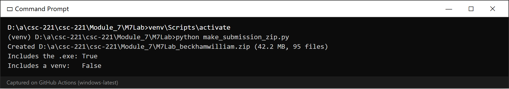

---

## Troubleshooting

| Problem | Fix |
|---|---|
| `'python' is not recognized` | Reinstall Python from python.org and tick **Add python.exe to PATH**, then open a new Command Prompt. |
| `Python was not found; run without arguments to install from the Microsoft Store` | Windows is using its Store shortcut instead of real Python. Install Python from python.org (tick **Add python.exe to PATH**), or turn off **Settings → Apps → Advanced app settings → App execution aliases → python.exe / python3.exe**. |
| `pip install` fails building **pandas** or **numpy** | Your Python is too new for the available pre-built packages. Install **Python 3.13** from python.org, delete the `venv` folder, and start again from 3.2. |
| Antivirus deletes or quarantines the .exe | PyInstaller one-file programs sometimes trigger false alarms. Restore the file, or add an exception for the `dist` folder. |
| The browser doesn't open | Copy the `http://127.0.0.1:...` address shown in the launcher window into your browser. |
| `Could not create the zip ... not found` | The .exe hasn't been built yet. Run step 3.6 (or `build_exe.bat`) first. |
