# M7Lab: Converting the Program Launcher to an .exe with PyInstaller

**William Beckham · CSC-221 Advanced Python Programming**

This document records every step of turning `launcher.py` into a stand-alone
executable, with a screenshot for each step.

- **Part 1:** the program being converted, and its unit tests
- **Part 2:** creating the virtual environment, installing PyInstaller and building
- **Part 3:** building and running the Windows `.exe`, and making the submission zip

> **Note on screenshots:** every terminal image is the real output of the
> command, captured as it ran. Parts 1 and 2 were done on Linux. Part 3 was
> built and tested on a real Windows machine (GitHub Actions `windows-latest`).

---

## Part 1: The program being converted

### 1.1 Launcher menu (input, results, Goodbye message)

The launcher asks the user to pick one of three programs, rejects invalid
input, starts the chosen Flask app, and says **Goodbye!** before closing.


### 1.2 Vet Services (M5Pro) Flask app

**Option 1: OWNER table** (also saved to `output/owner.csv`)

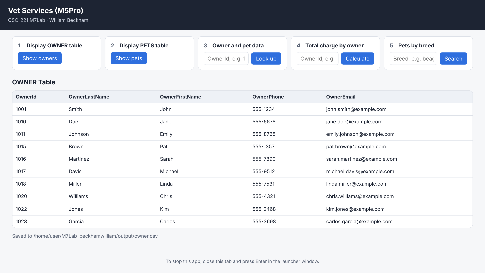

**Option 4: Total charge by owner**


**Option 5: Pets by breed (total and average charge)**

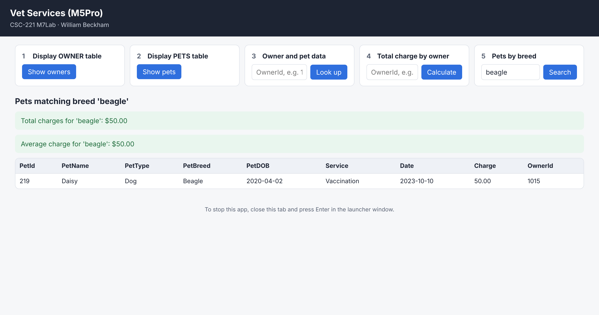

**Exception handling: invalid OwnerId**


### 1.3 Recipe Manager (M3Pro) Flask app

**View all recipes.** Caesar Salad's missing spice level is now reported
instead of showing 1 (instructor feedback #1).


**Search ignores punctuation:** "veggie stir fry" finds "Veggie Stir-fry" (feedback #3).


**New option: adjust sweetness/spice** uses `adjust_sweetness()` / `adjust_spice()` (feedback #2).


**Exception handling: a recipe with no level to adjust**

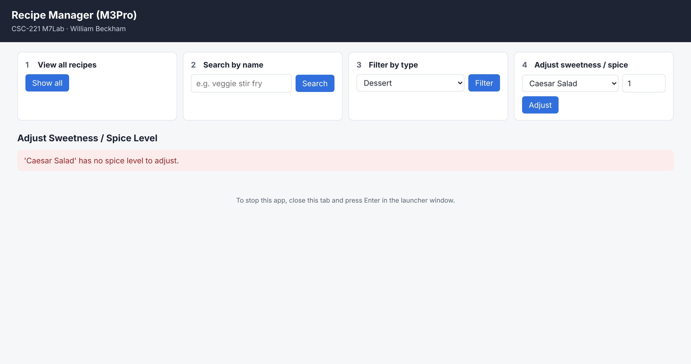

### 1.4 Dungeon RPG (started in CSC-121, built up in CTS-285) Flask app

The Tkinter desktop game was rewritten as web pages. The game rules are the
original code; only the screens changed. Keyboard controls (W/A/S/D, E, I,
K, C, R, Esc) work in the browser.

**Create a character.** Bad input (blank name, an age that isn't 1-100) shows an error.


**World map:** villages, towns, dungeons (with tier and level) and encounters.


**Village: quest board** (a d20 ability check vs DC) **and shop**

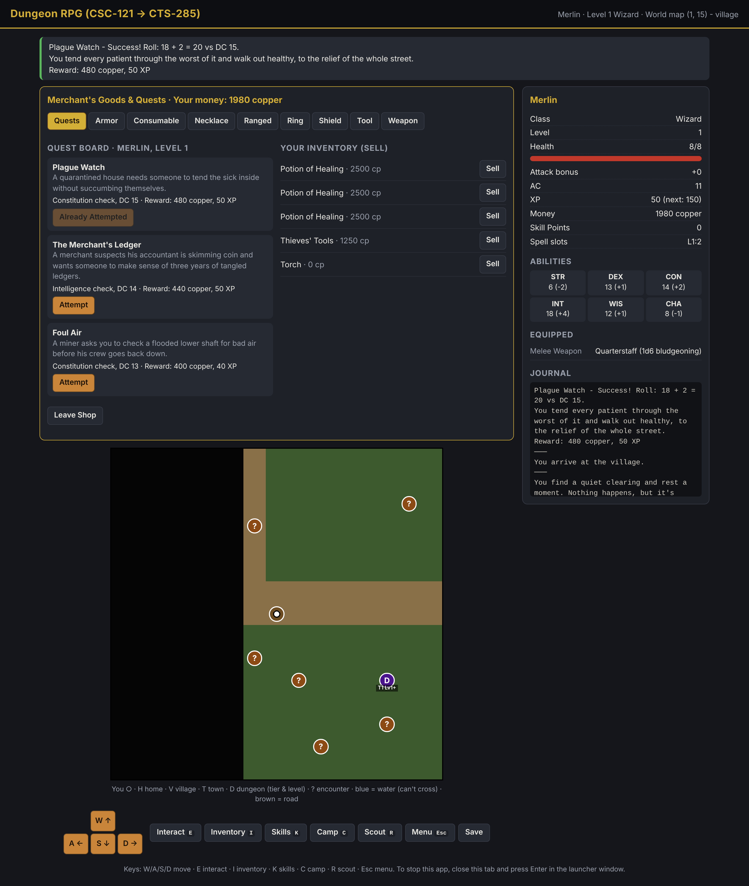


**Dungeon:** limited vision, doors, enemies, treasure, merchant and boss vault.

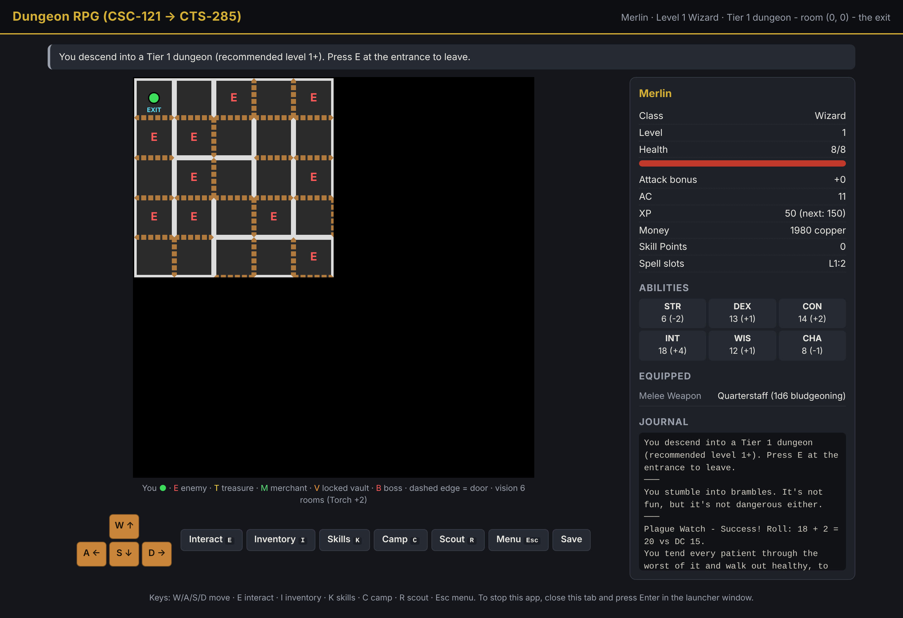

**Combat:** range bands, attack, advance/retreat, spells, abilities, items and flee.

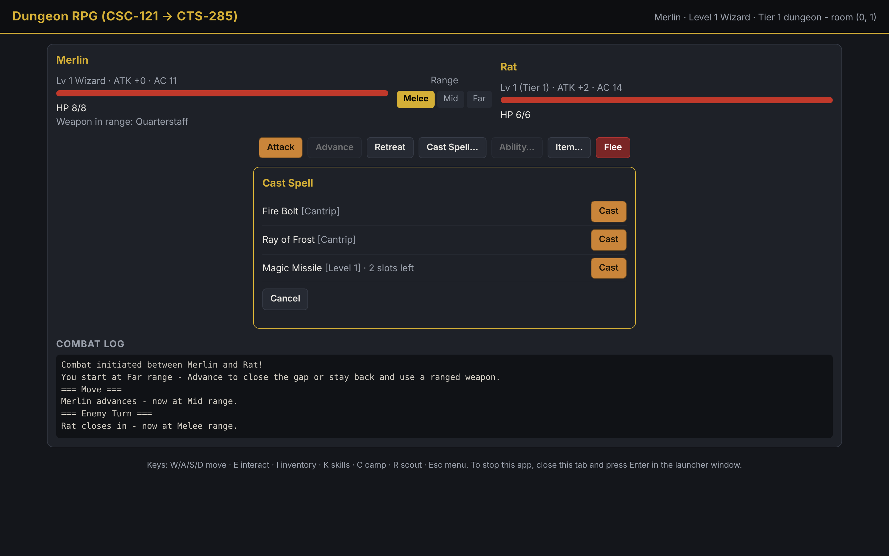


**Inventory, skill tree and pause menu (save/load)**

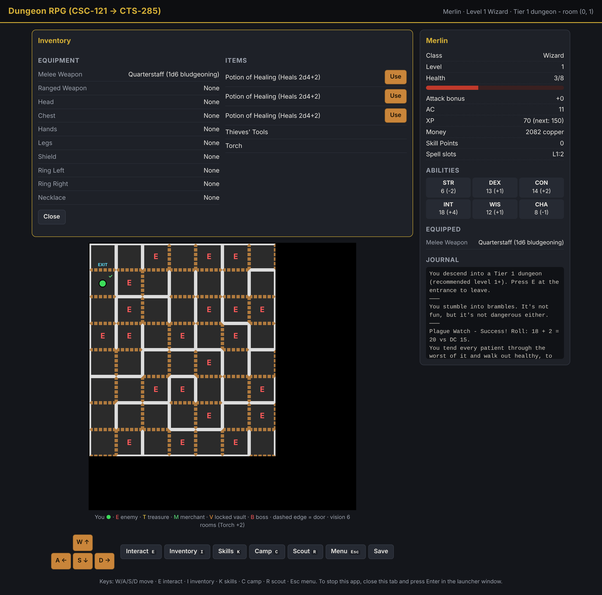

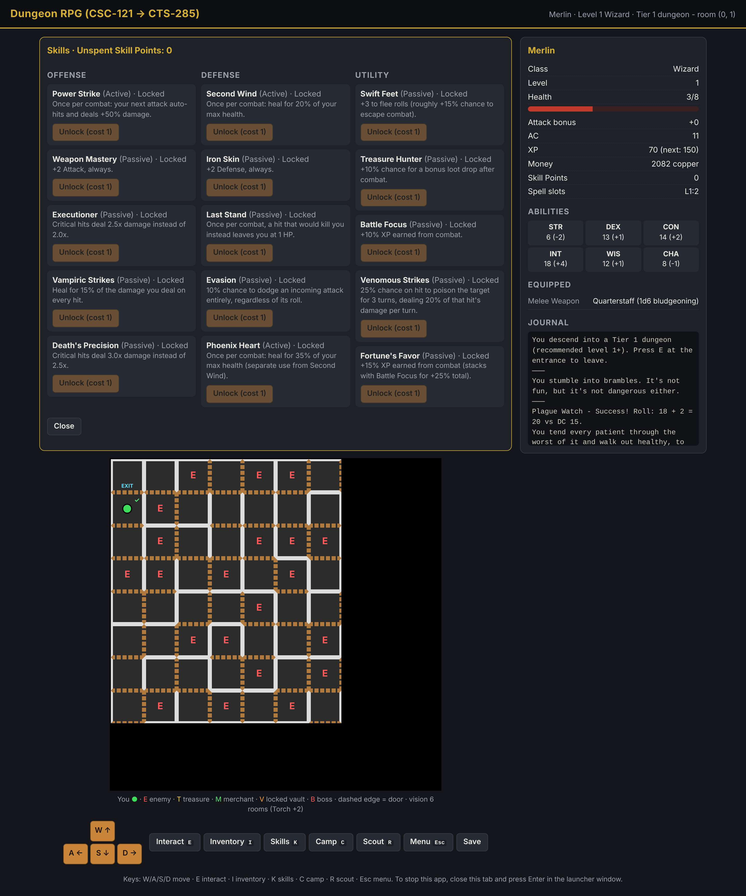


**Phone-width layout**

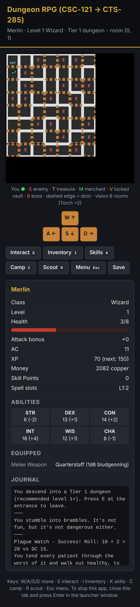

### 1.5 Exception handling: missing database (M5Pro instructor feedback)

With `vet_serv.db` deleted on purpose, the launcher reports the problem and
returns to the menu instead of crashing.


### 1.6 Unit tests (63 tests, all passing)

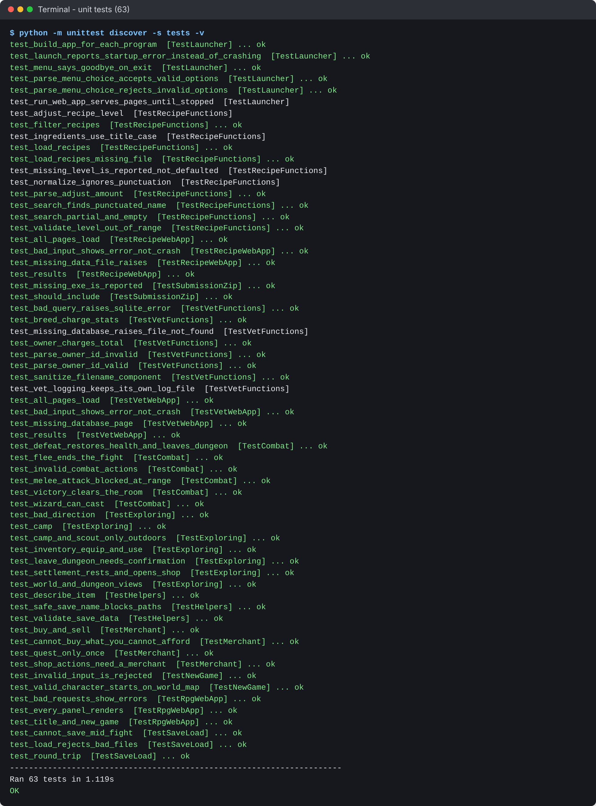

---

## Part 2: Virtual environment, PyInstaller and the build

This part was done on Linux to prove the whole process works before building
on Windows. PyInstaller always builds for the operating system it runs on, so
this produces a Linux program. Part 3 repeats the same steps on Windows to
make the `.exe`.

### 2.1 Create and activate a virtual environment

The venv keeps PyInstaller and the project's packages separate from the
system Python. `which python` shows we're now using the venv's Python.


### 2.2 Install PyInstaller and the project's packages into the venv

`requirements.txt` lists flask, pandas, openpyxl and pyinstaller.


### 2.3 Run the unit tests inside the venv

All the unit tests pass, which confirms the program works in the venv before converting it.

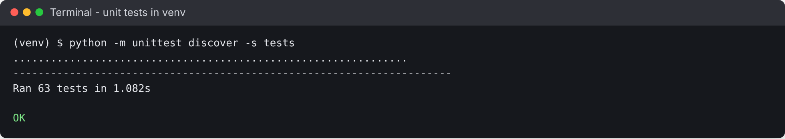

### 2.4 Build the executable with PyInstaller

| Option | Why |
|---|---|
| `--onefile` | Packs everything into a single executable file |
| `--console` | Keeps a console window, because the launcher menu needs typed input |
| `--clean --noconfirm` | Starts from a clean build and overwrites old output without asking |
| `--name M7Lab_Launcher` | Names the output file |
| `--add-data "templates:templates"` | Bundles the HTML pages (Flask needs them at run time) |
| `--add-data "vet_app/data:vet_app/data"` | Bundles `vet_serv.db` |
| `--add-data "recipe_app/data:recipe_app/data"` | Bundles `recipe_data.xlsx` |
| `--add-data "rpg_app/game/data:rpg_app/game/data"` | Bundles the Dungeon RPG's game data (classes, items, enemies, spells, skills, quests: 7 JSON files) |
| `--hidden-import openpyxl` | pandas loads openpyxl in a way PyInstaller can't see, so we name it |
| `launcher.py` | The entry point, the file whose menu the user sees |

The two `WARNING` lines are about `user32` and `msvcrt`, which are Windows
system libraries that don't exist on Linux. They don't affect the program.


### 2.5 The result in `dist/`

PyInstaller creates `build/` (temporary work files), `dist/` (the finished
program) and `M7Lab_Launcher.spec` (the saved build settings).


### 2.6 Run the executable on its own

The executable was copied **by itself** into an empty folder and run with no
venv and no Python. It shows the menu, rejects an invalid choice (`9`), runs
all three Flask apps, and says **Goodbye!** before closing.

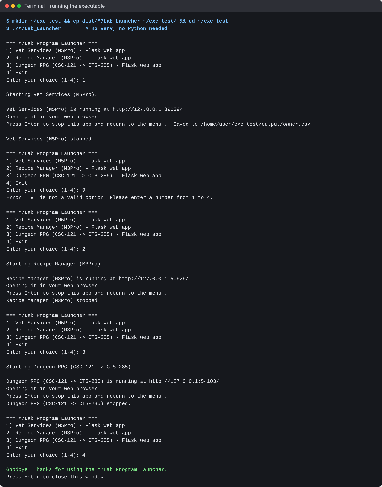

While it ran, both apps were opened in a browser. These pages were served by
the executable:


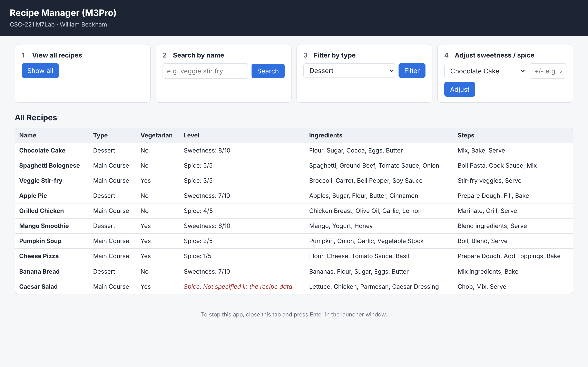


### 2.7 Files the executable created

The CSV output, the RPG save game and the log files are written **next to the
executable**, not inside PyInstaller's temporary folder, so they're still there
after the program closes. Each program keeps its own log file.

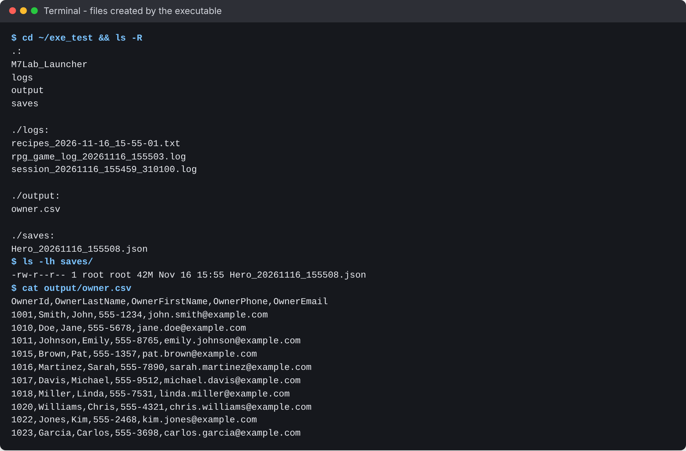

**Automated check of the built program: 14 of 14 passed.**

| Program | Checks |
|---|---|
| Vet Services | home page; OWNER table and CSV save; total charge for owner 1011 ($80.00); breed average ($50.00); bad-OwnerId error |
| Recipe Manager | missing level reported; punctuation-insensitive search; level adjustment |
| Dungeon RPG | title screen; bad age rejected; new game shows the world map; moving; inventory panel; saving a game |

The program exited with code 0.

---

## Part 3: The Windows .exe

PyInstaller builds for the operating system it runs on, so the Windows `.exe`
was built on a **real Windows machine**: a GitHub Actions `windows-latest`
runner (Windows Server 2025, version 10.0.26100) with Python 3.13.17. The
workflow (`.github/workflows/m7lab-windows-build.yml` in the `csc-221` repo)
runs the same `build_exe.bat` included in this project, tests the `.exe`, and
saves the screenshots below.

- **Build log:** [`windows_build/build_exe_log.txt`](windows_build/build_exe_log.txt)
- **Test results:** [`windows_build/check_results.txt`](windows_build/check_results.txt) (17/17 passed)
- **Full .exe session:** [`windows_build/exe_run_transcript.txt`](windows_build/exe_run_transcript.txt)

> The console images show the real output of each command on that Windows
> machine. The browser images are real screenshots of the pages the `.exe`
> served, taken with Chromium on Windows.

### 3.1 The project on Windows

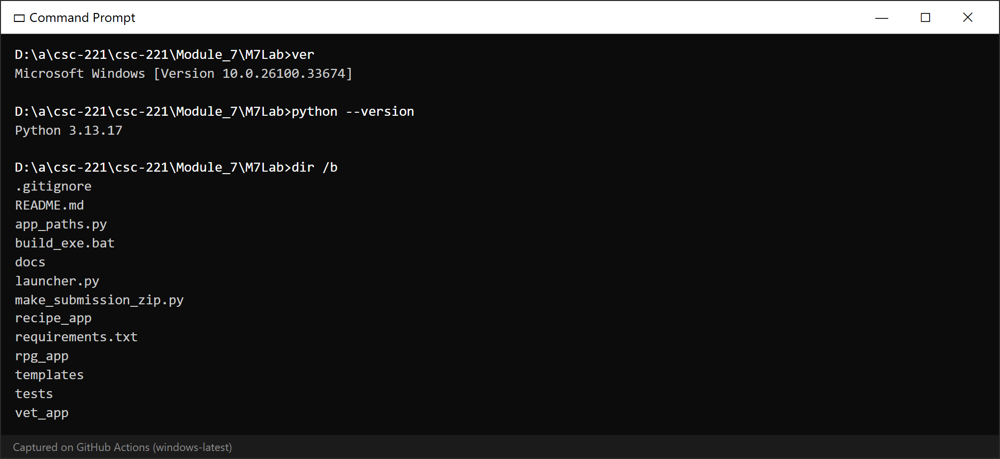

### 3.2 `build_exe.bat` creates and activates the virtual environment

`where python` points into `venv\Scripts`, so the venv is active.

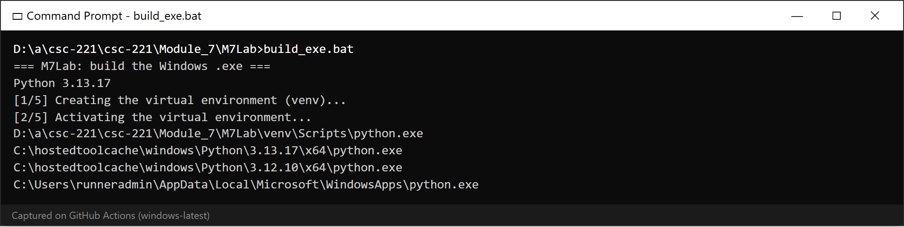

### 3.3 PyInstaller and the program's packages are installed into the venv


### 3.4 The unit tests run on Windows: 63 tests, OK

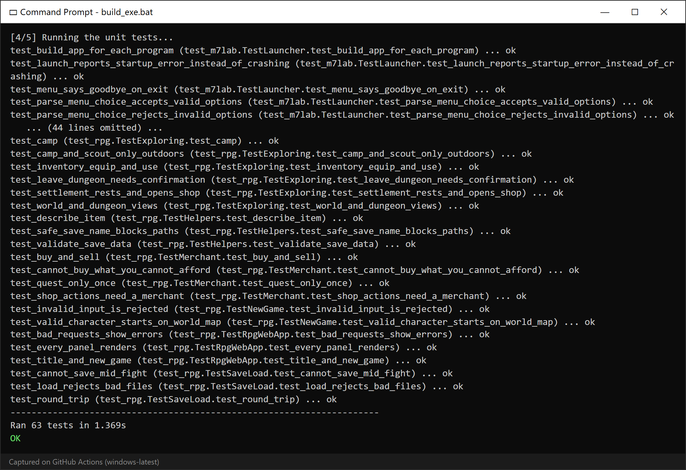

### 3.5 PyInstaller builds `dist\M7Lab_Launcher.exe`

Notice that the `user32` / `msvcrt` warnings from the Linux builds in Part 2
are gone. Those libraries exist on Windows.

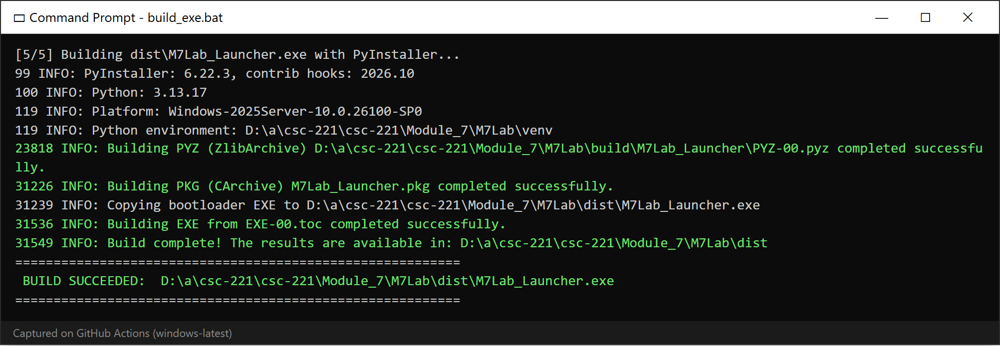

### 3.6 The .exe in `dist\`

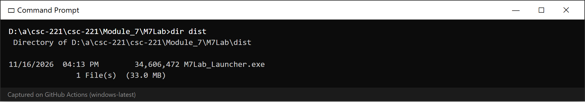

### 3.7 Running the .exe by itself

The `.exe` was copied **alone** into an empty temp folder and run with no
Python or venv. It shows the menu, rejects an invalid choice (`9`), runs all
three Flask apps, and says **Goodbye!** before closing.


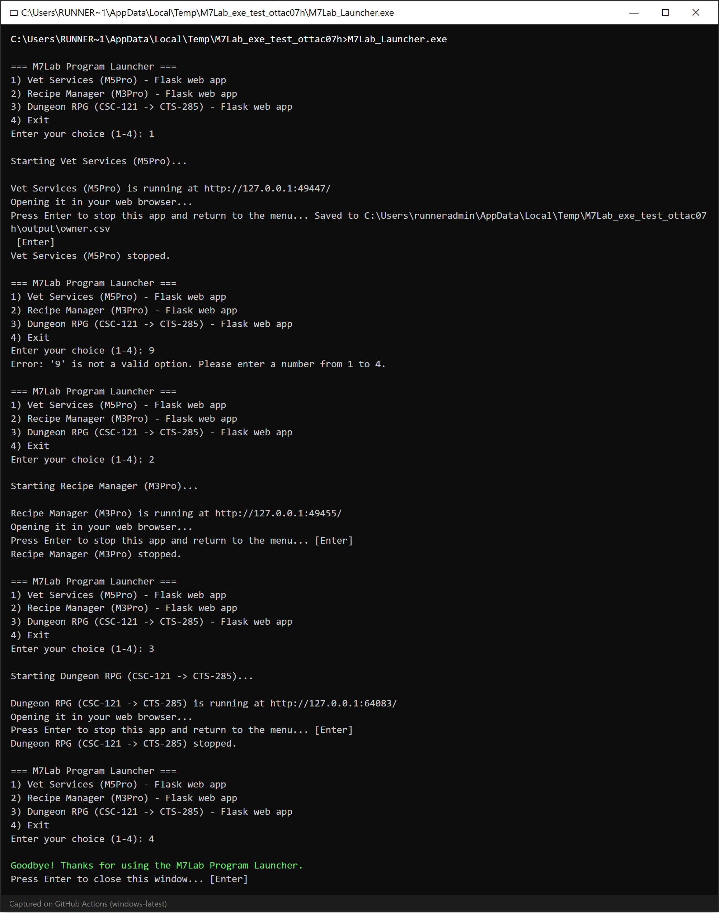

**The three programs, served by the Windows .exe:**

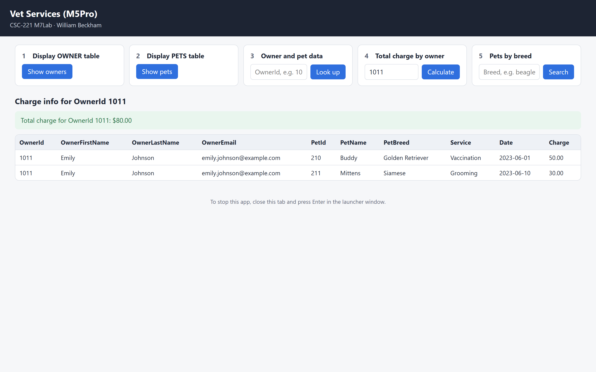

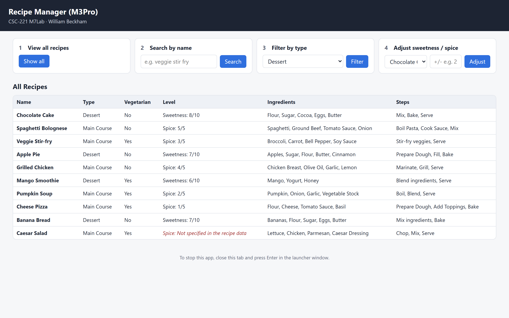

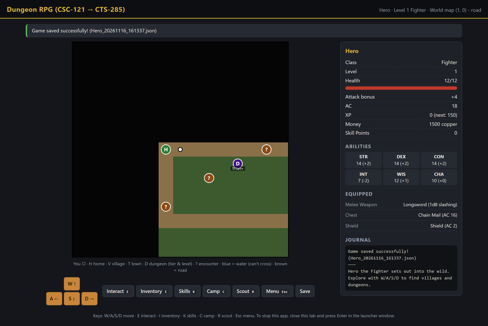

**Choosing 4 (Exit):**

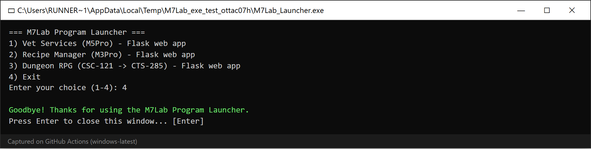

### 3.8 Files the .exe created next to itself

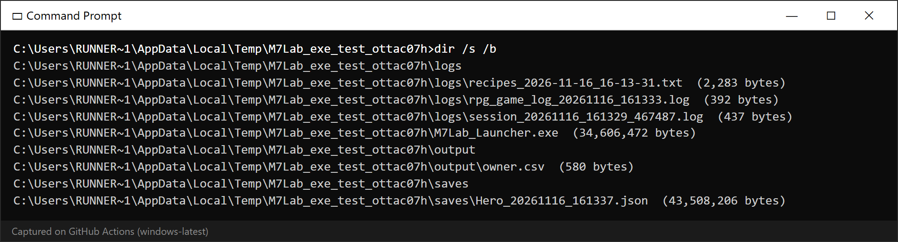

### 3.9 The submission zip (code + exe, no venv)


**Automated checks of the Windows .exe: 17 of 17 passed.** These were the
same 14 page checks as Part 2, plus: the `.exe` exits with code 0, the
submission zip is created, and the zip contains no venv.

---

## Building it yourself on your own PC

You can repeat the build on any Windows PC with Python from python.org
(tick **"Add python.exe to PATH"** when installing). Open Command Prompt in
the project folder: in File Explorer, click the address bar, type `cmd` and
press Enter. Then either double-click **`build_exe.bat`**, or run the steps
one at a time:

```bat
python -m venv venv
venv\Scripts\activate
pip install -r requirements.txt
python -m unittest discover -s tests
pyinstaller --onefile --console --clean --noconfirm --name M7Lab_Launcher ^
    --add-data "templates;templates" ^
    --add-data "vet_app\data;vet_app\data" ^
    --add-data "recipe_app\data;recipe_app\data" ^
    --add-data "rpg_app\game\data;rpg_app\game\data" ^
    --hidden-import openpyxl ^
    launcher.py
python make_submission_zip.py
```

The `.exe` appears in `dist\`. Double-click it to run. If Windows shows
**"Windows protected your PC"**, click **More info → Run anyway**.
PyInstaller programs aren't digitally signed, so SmartScreen warns about them.

## Troubleshooting

| Problem | Fix |
|---|---|
| `'python' is not recognized` | Reinstall Python from python.org and tick **Add python.exe to PATH**, then open a new Command Prompt. |
| `Python was not found; run without arguments to install from the Microsoft Store` | Windows is using its Store shortcut instead of real Python. Install Python from python.org (tick **Add python.exe to PATH**), or turn off **Settings → Apps → Advanced app settings → App execution aliases → python.exe / python3.exe**. |
| `pip install` fails building **pandas** or **numpy** | Your Python is too new for the available pre-built packages. Install **Python 3.13** from python.org, delete the `venv` folder, and start again from 3.2. |
| Antivirus deletes or quarantines the .exe | PyInstaller one-file programs sometimes trigger false alarms. Restore the file, or add an exception for the `dist` folder. |
| The browser doesn't open | Copy the `http://127.0.0.1:...` address shown in the launcher window into your browser. |
| `Could not create the zip ... not found` | The .exe hasn't been built yet. Run `build_exe.bat` (or the `pyinstaller` command) first. |
